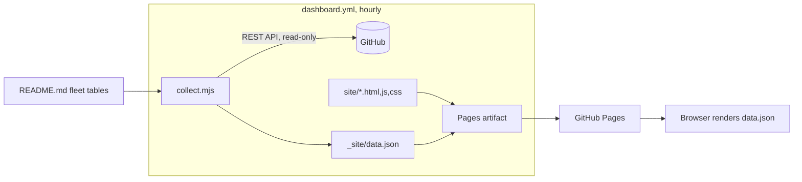

# Reference SDKs CI dashboard

A static GitHub Pages site showing CI health for every reference SDK, per
version branch. It is rebuilt hourly by
[`.github/workflows/dashboard.yml`](../.github/workflows/dashboard.yml).

## What is shown

One row per SDK version branch:

| Column | Source | Meaning |
| --- | --- | --- |
| Renovate PRs | open PRs into the branch by Renovate, plus Actions runs for their head SHA | `no CI run` means no workflow run exists for the PR head after 15 minutes. `didn't start` means `startup_failure`; `needs approval` means `action_required`. |
| Build | `Pack …` step of the latest `build.yml` run (**PR**) and `upload.yml` run (**Release**) | `setup failed` means the job failed before packing (runner, LXD or sdkcraft install). |
| Tests | `Run tests …` / `Test …` steps of the same runs | `not run` for uploads that do not set `run-tests`. Flags branches without `tests/spread.yaml`. |
| Store publish | `Upload SDK …` steps of the latest `upload.yml` run, per platform | Also flags branches whose latest publish failure is newer than their latest success. |
| Last published | newest successful `Upload SDK …` step per platform | Looks back through up to 10 uploads, then the last successful run of `upload.yml`. |
| Recent runs | last 10 `build.yml` and `upload.yml` runs in the window | One dot per run, oldest first. |

The SDK cell adds repository-level Renovate signals:

- the Renovate **Dependency Dashboard** issue, with its "Repository problems"
  and other actionable sections (`Errored`, `Rate-Limited`, `PR Edited (Blocked)`, …)
  and any stale duplicate dashboards from the old self-hosted Renovate;
- the latest manual `renovate.yml` and `renovate-check.yml` runs;
- every run in the window with `startup_failure` or `action_required`, on any
  workflow. These are the runs that "fail to run" and never report a check.

Clicking a summary tile filters the table to that problem class. Failing jobs
expand to show their check-run annotations.

## Design



- **Fleet**: SDK repositories are parsed from the tables in the root
  [README.md](../README.md) (excluding "Utilities & Templates"), so adding an
  SDK to the README adds it to the dashboard.
- **Version branches**: the union of `LONG_TERM_BRANCHES` (when readable),
  numeric branch names, and branches with `upload.yml` runs. Branches outside
  `LONG_TERM_BRANCHES` are dimmed.
- **Classification** is by workflow file (`build.yml`, `upload.yml`,
  `renovate.yml`, `renovate-check.yml`) and by the step names emitted by the
  `canonical/sdkcraft-actions` reusable workflows. PR runs whose
  `pull_requests` list is empty are mapped to their base branch through the PR
  list, then through the `renovate/<branch>-…` naming.
- **Cost**: about 15 requests per SDK plus 3–5 per branch, roughly 400 requests
  per refresh for the current fleet. A failing repository is reported in the
  page; if every repository fails, the job fails and the previous deployment
  stays live.
- **Security**: the collector only reads. The page renders data with
  `textContent`, only links to `https://github.com`, and ships a restrictive
  Content Security Policy. Everything in `data.json` is public: do not point
  the collector at private repositories.

## Setup

1. In the repository settings, set **Pages → Source** to **GitHub Actions**.
   This replaces the current branch-based Pages site (the rendered README).
2. Optionally add an `SDK_READ_TOKEN` secret: a fine-grained PAT with
   **Actions**, **Contents**, **Issues**, **Pull requests** and **Metadata**
   read on the SDK repositories, plus **Variables** read to use
   `LONG_TERM_BRANCHES`. Without it the workflow uses `GITHUB_TOKEN`, which
   can read public repositories only, and falls back to branch-name detection.
3. Run the **SDK dashboard** workflow manually once.

## Local development

Requires Node.js 22+ and no dependencies.

```sh
cd dashboard
npm test
GITHUB_TOKEN=$(gh auth token) npm run build   # writes _site/
npm run preview                               # http://localhost:8000
```

Limit collection to some SDKs with
`node collect.mjs --readme ../README.md --out _site/data.json --only canonical/go-sdk`.
`--days` changes the run window (default 30).
